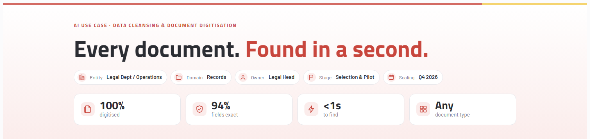
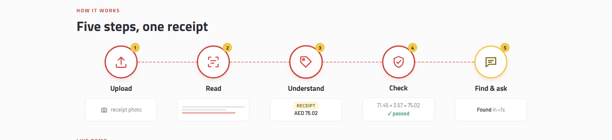
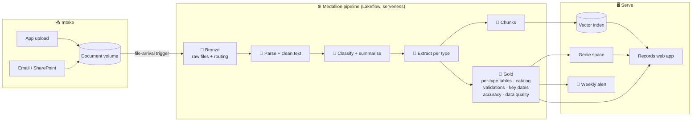
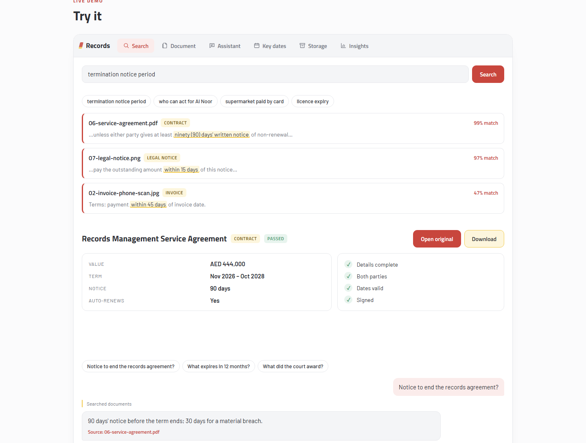
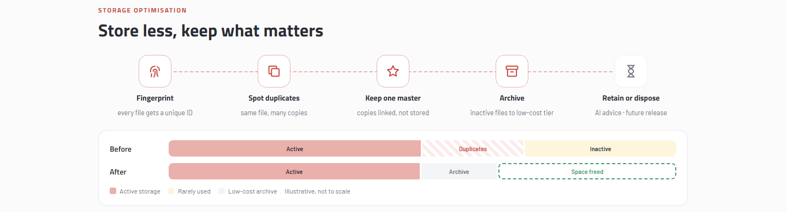

<div align="center">

# 📄 Document Intelligence

### Every document. Found in a second.

AI pipeline and web app that turns scanned and digital business documents into clean, validated, searchable records.

[](https://www.databricks.com/)
[](pipeline/src)
[](pipeline/src/transformations)
[](app)
[](pipeline/config/vector_search_index.json)
[](LICENSE)



</div>

---

## ✨ What it does

Legal, HR, admin and compliance teams keep thousands of documents: invoices, contracts, court judgments, trade licences, IDs, letters and more. They arrive as PDFs, phone photos, scans and Word files, often in English and Arabic. Finding one usually means opening many.

**Document Intelligence** reads every file automatically and:

| | Capability | How |
|---|---|---|
| 🔍 | **Reads any format** | OCR and layout parsing for PDF, scans, photos, Word, PowerPoint, text and email |
| 🏷️ | **Classifies** | 12 document types, chosen by AI from a config-driven registry |
| 🧾 | **Extracts fields** | A different schema per type (invoice totals, contract notice periods, licence expiry dates…) |
| ✅ | **Cleans and validates** | Text cleaning, typed dates and amounts, per-type business rules (e.g. *subtotal + tax = total*) |
| 📊 | **Measures accuracy** | Every extracted field scored against an answer key: **94.5% exact, 100% including partial matches** |
| 🔎 | **Makes it searchable** | Hybrid (keyword + semantic) vector search over document chunks |
| 💬 | **Answers questions** | An assistant that cites source files, plus natural-language questions over the tables |
| ⏰ | **Flags key dates** | Expiries, renewal-notice deadlines and hearings, with a weekly email alert |
| ⚡ | **Runs itself** | Drop a file in and it's searchable about 6 minutes later |



---

## 🏗️ Architecture



### Medallion layers

| Layer | Table | Purpose |
|---|---|---|
| 🥉 Bronze | `raw_documents` | Every file, its hash and its route: `ai_parse`, `text`, `excluded` or `unsupported` |
| 🥈 Silver | `parsed_documents` | Text from `ai_parse_document` (or UTF-8 decode), cleaned of HTML tags, whitespace and noise |
| 🥈 Silver | `documents_classified` | `ai_classify` type + `ai_summarize` summary |
| 🥈 Silver | `documents_extracted` | `ai_extract` with a literal schema per type (one flow per type, generated from the registry) |
| 🥈 Silver | `document_chunks` | Search-ready chunks with metadata → Delta Sync vector index |
| 🥇 Gold | `invoices`, `contracts`, `trade_licences`, … | One typed table per document type with `check_*` columns and `validation_status` |
| 🥇 Gold | `document_catalog` | One row per file: type, summary, core fields, status, failed checks |
| 🥇 Gold | `document_validations`, `data_quality_summary` | Every rule result and the pass rate per stage |
| 🥇 Gold | `extraction_accuracy` | Field-by-field comparison with the answer key |
| 🥇 Gold | `key_dates` | Every date to act on, with days left, urgency and the responsible team |
| 🥇 Gold | `invoice_line_items`, `vendor_spend_monthly` | Finance analytics |

### Schema registry: new document types without new code

Document types, fields, extraction instructions and validation rules live in
[`pipeline/config/extraction_schemas.json`](pipeline/config/extraction_schemas.json).
Adding a type is a config change: the pipeline generates its extraction flow, gold table and checks automatically.

```jsonc
{
  "document_type": "trade_licence",
  "description": "Commercial or trade licence issued by an authority permitting a business to operate",
  "gold_table": "trade_licences",
  "fields": {
    "expiry_date": { "type": "string", "format": "date" },
    "activities":  { "type": "array", "items": { "type": "string" } }
  },
  "validation_rules": [
    { "name": "expiry_after_issue", "expression": "expiry_date > document_date" },
    { "name": "not_expired",        "expression": "expiry_date >= current_date()" }
  ]
}
```

---

## 🖥️ The Records app

A React + TypeScript web app ([`app/`](app)) running as a Databricks App. Every query runs **as the signed-in user**, so Unity Catalog permissions apply.

| Page | What you get |
|---|---|
| **Search** | Hybrid search with type filters, highlighted snippets and match scores |
| **Document** | Every extracted field, validation checks, summary and the original file to open or download |
| **Library** | All validated documents with filters, plus **Add document** upload |
| **Key dates** | Overdue and upcoming expiries, deadlines and hearings |
| **Assistant** | Chat that searches document text and queries the tables, always citing the source file |
| **Insights** | KPIs, accuracy by type and data-quality results |



---

## 🗄️ Storage optimisation



Every file gets a SHA-256 fingerprint in bronze, so duplicates are detected regardless of file name.

---

## 📁 Repository layout

```
.
├── pipeline/                       Databricks Asset Bundle: pipeline, job, alert, Genie space
│   ├── databricks.yml
│   ├── resources/                  pipeline + file-arrival job definitions
│   ├── src/transformations/        01–13: bronze → silver → gold (SQL + Python)
│   ├── src/jobs/                   vector index refresh
│   ├── config/                     schema registry + vector index spec
│   ├── genie/                      Genie space builder
│   ├── alerts/                     weekly key-dates alert
│   └── scripts/                    registry loader, search CLI, access grants
├── app/                            Records web app (AppKit: React, Express, TypeScript)
│   ├── client/src/pages/           Search, Document, Library, Key dates, Assistant, Insights
│   ├── server/                     plugins + Records Assistant agent
│   └── config/queries/             parameterised SQL (run as the user)
├── prototype/                      Vendor-neutral visual walkthrough (open in a browser)
├── sample-documents/               Synthetic and specimen test documents + answer key
└── docs/                           Email / Teams integration guide, images
```

---

## 🚀 Getting started

**Prerequisites:** a Databricks workspace with Unity Catalog, serverless compute and AI Functions; Databricks CLI ≥ 0.250; Node.js 22+.

```bash
# 1. Point the bundles at your workspace
#    edit host / root_path in pipeline/databricks.yml and app/databricks.yml

# 2. Create the catalog, schemas and volume, then upload sample-documents/ to the volume
databricks catalogs create document_intelligence
databricks volumes create document_intelligence default document_intelligence_sample MANAGED

# 3. Load the schema registry and deploy the pipeline + job
cd pipeline
python scripts/load_schema_registry.py
databricks bundle deploy -t dev
databricks bundle run doc_intelligence_medallion -t dev

# 4. Create the vector index (spec in config/vector_search_index.json) and the Genie space
python genie/build_genie_space.py

# 5. Deploy the app
cd ../app
npm install
databricks bundle deploy && databricks bundle run app
```

See [`pipeline/README.md`](pipeline/README.md) for details and [`docs/INTEGRATIONS_SETUP.md`](docs/INTEGRATIONS_SETUP.md) for email and Microsoft Teams intake.

---

## 📈 Results on the test set

| Metric | Result |
|---|---|
| Documents processed | 43 passed every check |
| Field accuracy (exact) | **69 / 73 = 94.5%** |
| Field accuracy (incl. partial) | **100%** |
| Upload → searchable | ~6 minutes, fully automatic |
| Document types | 12, added by config |

---

## 🛠️ Built with

**Databricks:** Lakeflow Declarative Pipelines · Unity Catalog · AI Functions (`ai_parse_document`, `ai_classify`, `ai_extract`, `ai_summarize`, `ai_prep_search`) · Vector Search · Genie · Databricks Apps · Lakeflow Jobs · SQL Alerts · Asset Bundles
**Models:** Llama 3.3 70B (assistant) · GTE-Large (embeddings)
**App:** React · TypeScript · Tailwind CSS · Express · AppKit

---

<div align="center">

Built by **Ashwinth Dharumaseelan** · Released under the [MIT License](LICENSE)

</div>
